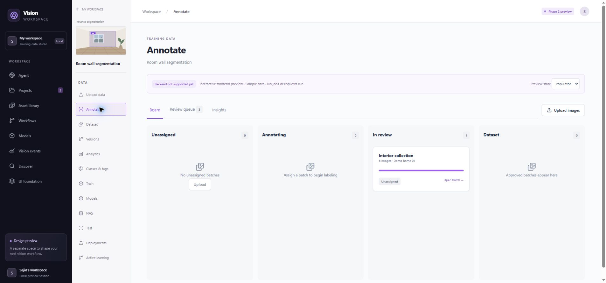
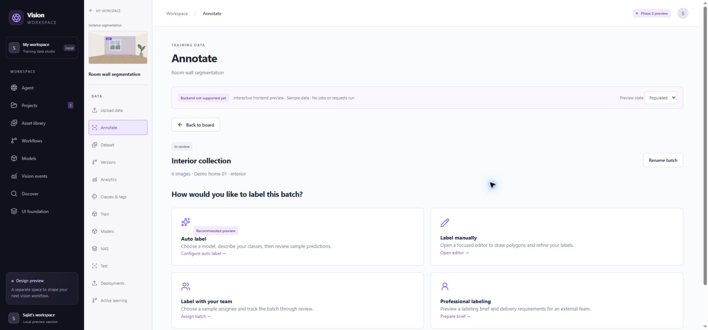
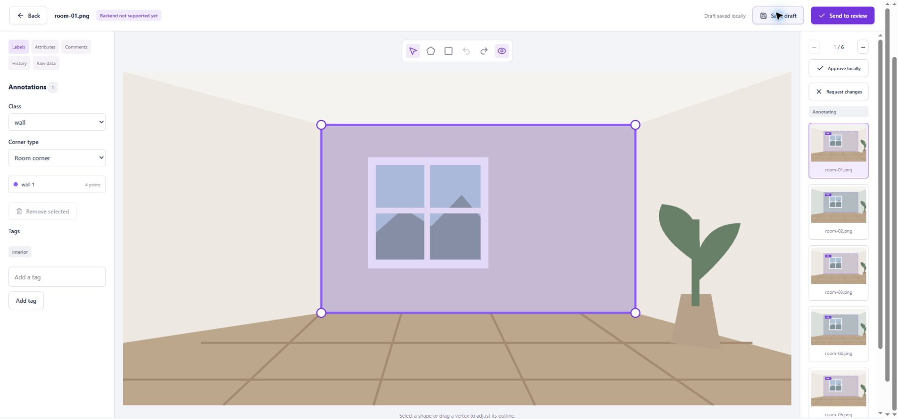
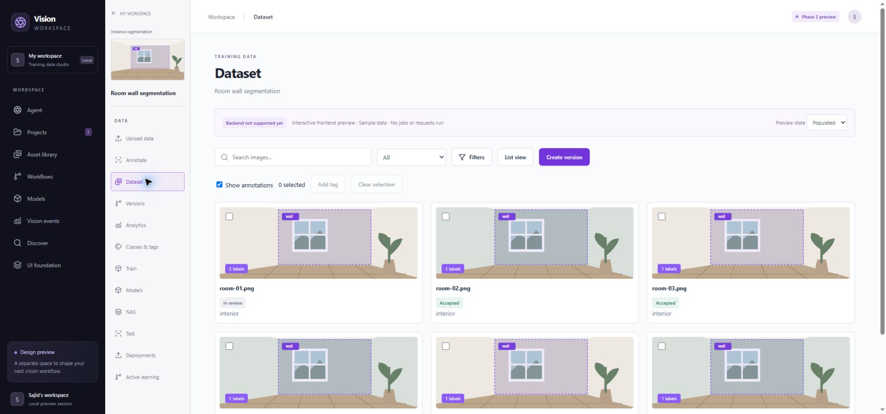
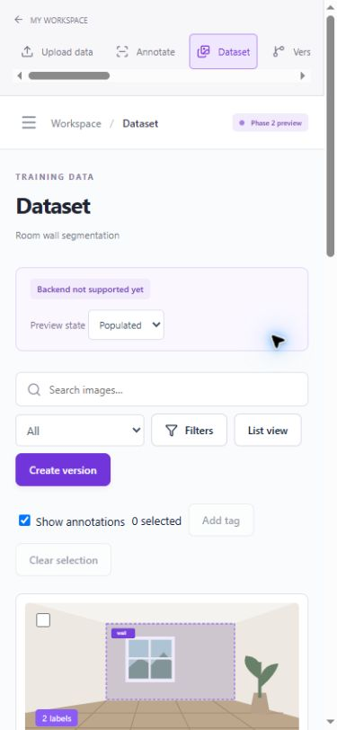
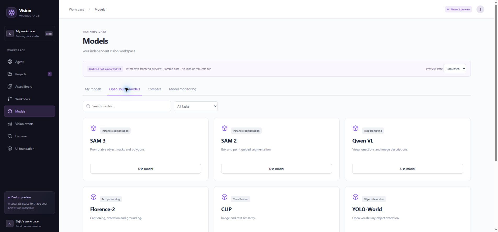
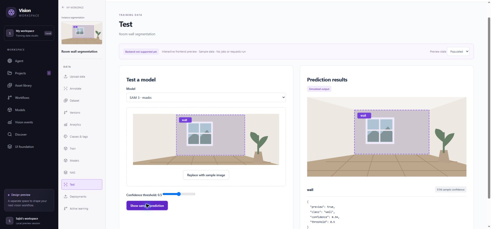
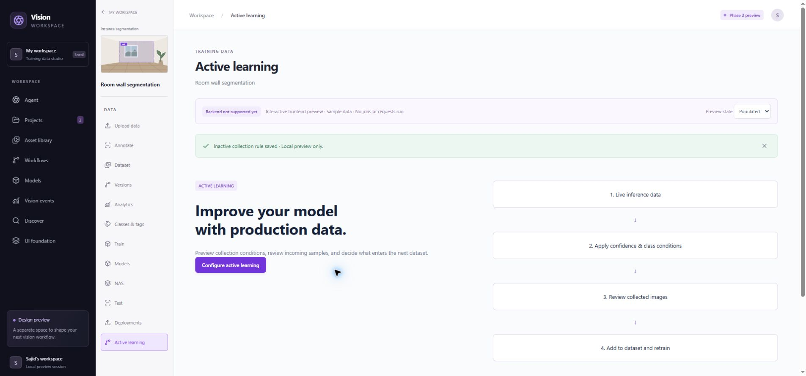
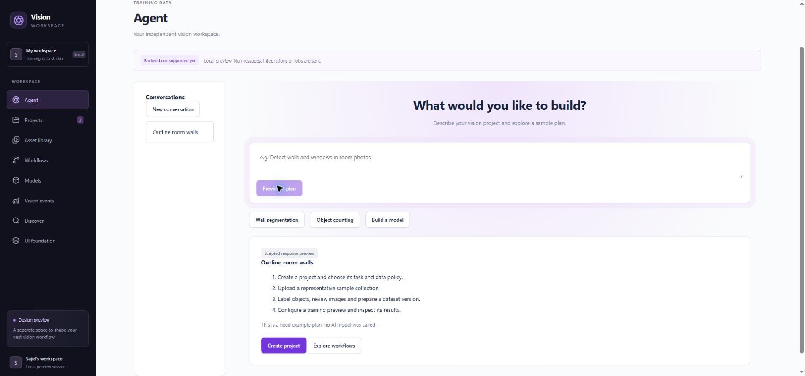

# Phase 2 screen review

Date: 2026-10-15. Owner/reviewer: Sajid. Status: prototype ready for review; NOT APPROVED. No backend integration or release is authorized by this status.

Open http://127.0.0.1:5174/training-data/#projects. This standalone app is entirely inside `training-data/`. Existing port 5173 and the AADML dashboard remain unchanged.

## Review sequence

1. Projects: hover/focus Projects for the recent-project flyout; search/filter/sort; grid/list; create a folder and assign projects. Open New project.
2. Creation: enter name and intended use; select visibility, annotation sharing and task. Classification has single/multi-label choices. Expand additional task types. Continue through the five data-use questions, confirmation, editable review and local creation. Cancel supports keeping/discarding edits.
3. Open a project: its dedicated navigation opens Upload. Add a synthetic sample or local JPEG/PNG/WebP, batch name/tags, source, permission source and grouping. Save and Continue transfers images to the annotation board. Source cards offer local mobile/cloud/discovery/bulk configuration previews.
4. Annotation board: open a batch. Choose Auto label, Manual, Team or Professional. Team assigns a sample user; professional saves a brief; no messages are sent. Board includes insights and a review queue.
5. Auto label: choose model category, prompt and model; generate an explicitly synthetic result, then apply it to that batch's review queue.
6. Manual editor: draw polygon/box, select/move vertices, undo/redo, add tags, inspect attributes/comments/raw geometry, save drafts, send to review, approve or request changes. Unsaved edits have a discard confirmation. Geometry is local preview data.
7. Dataset: search/filter, grid/list, select images, bulk tags, annotation badge toggle, open editor. Classes/tags: add/edit definitions, colors, class locking and counts.
8. Versions: source/name, split purpose, preprocessing, augmentation, review/create. Inspect saved configuration. Test/golden versions are unavailable in the training selection.
9. Analytics: local image/annotation/class counts, review readiness, illustrative dimensions, CSV export.
10. Train: engine, version, architecture, size, epochs, review and simulated result. Models: local results, weight-registration draft, catalog/search/task filter/use choice, illustrative comparison and monitoring configuration.
11. Test: sample image, model selection, confidence threshold and fixed sample output. NAS: search landing leading to training configuration. Deployments: mode and language tabs, illustrative snippets, configuration and workflow drafts.
12. Active learning: source/class/confidence/limit dialog and inactive local rule drafts.
13. Workspace extras: Agent composer with clearly scripted response/history; searchable assets/details; workflow block draft editor; sample event filtering; discovery catalog/import handoff.

Studio pages expose Populated, Empty, Loading and Error previews. Retry restores the local view. Configuration pages can remain usable without data. Refresh resets in-memory work. Some workspace component state also resets on leaving that screen.

## Boundaries and limitations

- All services show Backend not supported yet; this means this prototype is not connected, not that every existing backend capability is absent. Phase 1 contract/gap reports remain the source for real integration.
- No requests to backend APIs, inference providers, storage, vendors or production services; no real training, messages, billing or deployment.
- Uploaded image previews stay in browser memory. Use synthetic samples for review. Pending object URLs are revoked on removal/unmount; transferred image URLs live for the page session. Reload releases the browser document.
- Project policies are UI choices only. No retention, privacy, authorization or deletion enforcement is claimed.
- Catalog models, curves, metrics and predictions are illustrative. Dataset splits/preprocessing/augmentation do not run. Mobile links/QR and cloud credentials are deliberately not generated.
- Annotation tools demonstrate polygon and box workflows. Specialized video timelines, keypoint skeletons, raster masks and OCR editors are not implemented; task choice previews do not claim full specialized editing engines.
- Phone/cloud/bulk import and deployment forms are configuration previews; actual import/processing is unsupported. Local file preview accepts JPEG, PNG and WebP only.
- This is design review scope, not a production implementation or pixel-identical Roboflow clone. Synthetic SVG scenes replace customer photos.

## Verification actually performed

- PASS: isolated Vite production build, 1741 modules transformed.
- PASS: `node --test training-data/tests/previewState.test.mjs` (2/2): new-project isolation, batch/image linkage, independent annotation fixture state. These are local-state tests, not server authorization tests.
- PASS in Chrome: board -> labeling choices -> auto-label preview -> four-image review queue; editor approval updates accepted counts; remove/undo/save; three-point polygon creation and send-to-review; version wizard -> named version in training review; simulated training -> model -> test output; active-learning draft; Error -> Retry; Agent scripted response; model catalog.
- Earlier step checks: project details/policy validation and review, local project creation, upload sample/provenance validation and handoff (see step review).
- Desktop editor and dataset screenshots visually inspected. 390px dataset viewport checked (document width 375px within 390px viewport); restored normal viewport afterward.
- NOT RUN: exhaustive browser coverage, all dialogs/fields, actual OS file/folder chooser and drag/drop, real imports, cross-browser/touch drawing, full accessibility audit, security/dependency scans or backend integration/auth/tenant checks. No backend change was made.
- Git review: no tracked frontend diff; only the untracked `training-data/` directory. No commit, push or deployment.

## Captured screens

## Change and rollback note

Low-impact local prototype using synthetic examples. Data risk increases if actual photos are selected, so screenshots/checks used sample data only. No backend controls or credentials changed. Rollback: stop the dedicated preview process and revert only desired files within `training-data/`; shared dashboard/backend require no rollback. User review and explicit approval remain required before the next phase.
